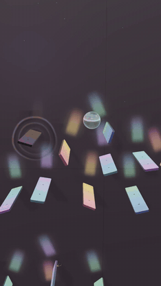

# Music Marbles Studio · 音乐弹珠

把一首 MP3、M4A 或 WAV 拖进浏览器，生成一段配着原曲的竖屏动画。钢琴音落下时，玻璃球撞弯墙上的琴片，一圈水纹从琴片中心散开；乐句拉长时，球沿导轨滚向下一次碰撞。音频分析和视频渲染都在本机完成。



[下载有声演示 MP4](docs/demo.mp4?raw=true) · [下载原创示例《夜航》](test-assets/夜航-原创测试曲.wav?raw=true)

## 在 macOS 上运行

准备 **Node.js 22.12 或更新版本、Python 3.9–3.12、Google Chrome** 和 Xcode 命令行工具。安装脚本会创建 Python 虚拟环境，安装依赖，并下载 FFmpeg。第一次安装需要联网。

```sh
git clone https://github.com/qq961242120/music-marbles-studio.git
cd music-marbles-studio
npm run setup
npm run dev
```

打开 [本机生成器](http://127.0.0.1:7100)，先拖入 `test-assets/夜航-原创测试曲.wav` 即可试跑。生成完成后，可以在页面播放或下载 MP4。也可以双击仓库中的 `启动.command` 启动。服务默认监听本机回环地址。

如果需要指定 Python，在首次安装时运行 `PYTHON=/path/to/python3 npm run setup`。Chrome 在自定义位置时，将 `CHROME_PATH` 设为浏览器可执行文件的绝对路径。

## 导出一首歌

保持服务运行，在另一个终端运行以下命令。

```sh
npm run export -- "test-assets/夜航-原创测试曲.wav" "夜航-音乐弹珠.mp4"
```

默认导出 **1080 × 1920、原生 60 fps、H.264 + AAC**。每个视频帧都按物理时间独立渲染。原声相对画面延后 **3 帧（50 毫秒）**，片尾保留完整音频。帧率和音轨偏移写在 [export-settings.json](export-settings.json)。单个输入文件上限 200 MB，完整歌曲按帧渲染，耗时随歌曲长度和本机 GPU 性能变化。

一次任务的输入、击板计划、试听音轨和成片都保存在 `data/jobs/<任务 ID>/`，成片为 `output.mp4`。

## 音乐怎样变成动作

- **选音。** 分析器分别计算左右声道的频谱能量，找出乐句中的重音，并检查余音里是否有新音高接过旋律。强混响和密集多乐器混音仍可能多选或漏选，示例适合先用钢琴或打击乐试听。[音频分析](analysis/analyze.py) · [重音与换音筛选](analysis/phrase_accents.py)
- **排轨。** 击板时刻确定后，程序反推板面朝向与球的路线，检查球、琴片和导轨的间隙。球在空中受重力作用，接触时由弹性和阻尼决定压弯量与离板速度。[路线规划](src/clear-route.js) · [弹性接触](src/contact-motion.js)
- **成像。** Three.js 绘制玻璃球、琴片、轨道和墙面。每道水纹以撞击瞬间的琴片中心为起点，在墙面坐标中扩散；输入音轨带有可读的内嵌时间歌词时，场景也可显示歌词。[玻璃折射](src/glass-ball.js) · [墙面水纹](src/wall-ripples.js)

## 开发与复验

```sh
npm run build
.venv/bin/python scripts/check-musical-onsets.py
.venv/bin/python scripts/check-overlapping-melody.py
```

构建后可用 `npm start` 提供生产页面。服务运行时，`node scripts/check-refraction.mjs` 在 Chrome 中检查折射和前景遮挡；`node scripts/check-wall-ripples.mjs <任务ID>` 逐个检查击板和水纹的对应关系。

需要在 IINA 中按一帧试听音画偏移时，另见 [macOS 逐帧校准器](tools/iina-frame-tuner/README.md)。

## 许可

项目源码和随仓库发布的原创演示素材采用 [GPL-3.0-or-later](LICENSE)。第三方工具、图标及编排灵感列在 [CREDITS.md](CREDITS.md)。
